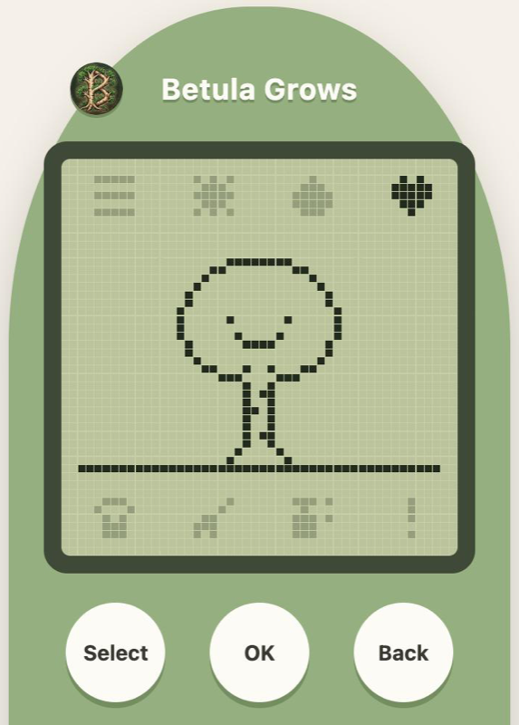

# Betula Grows

A tiny virtual pet in the spirit of the original Tamagotchi. Look after Betula,
a small birch tree, from seed to birch in one cozy 24-hour life.

## [Play Betula Grows](https://berkanagames.com/betula-grows)

## How to play

- **One life, 24 hours.** Betula starts as a seed and grows into a sprout,
  a sapling and finally a birch tree, in real time. She keeps growing while
  the game is closed.
- **Three needs.** Sun, water and company slowly run low over about four hours.
  Tap the icons on the screen, or use Select and OK, to look after her.
  Open the menu to see how she is doing. When a need runs low Betula looks sad,
  but she never dies.
- **Gifts.** At the end of each life Betula leaves you a gift and starts again
  as a seed. The better you cared for her, the better the chance of a rare one.
  Gifts stay in your collection forever.

Your game is saved in your browser, so each phone or computer has its own Betula.

## Coming soon in version 1.1

- More menu pages: stats, your gift collection and sound on/off
- An attention icon that lights up when Betula needs something
- 8-bit sounds
- Day and night: a lamp, and Betula sleeping through the night
- Fallen leaves to sweep and pests to spray away
- Left or right: a little guessing game with a bird
- Gentle animations: swaying, happy jumps, sleeping and growing up

## Made with

Made with plain HTML, CSS and JavaScript. Every sprite is pixel art drawn in code.

## About

Made by [Berkana Games](https://berkanagames.com).

© 2026 Berkana Games. All rights reserved.
