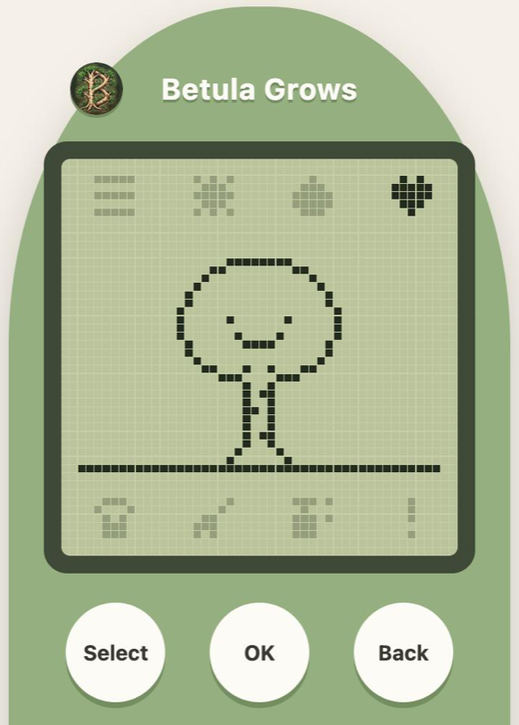

# Betula Grows

A tiny virtual pet in the spirit of the original Tamagotchi. Look after Betula,
a small birch tree, from seed to birch in one cozy 24-hour life.

## [Play Betula Grows](https://berkanagames.com/betula-grows)

## How to play

- **One life, 24 hours.** Betula starts as a seed and grows into a sprout,
  a sapling and finally a birch tree, in real time. She keeps growing while
  the game is closed.
- **Three needs.** Sun, water and company slowly run low over about four hours.
  Tap the icons on the screen, or use Select and OK, to look after her.
  Open the menu to see how she is doing. When a need runs low Betula looks sad,
  the attention icon blinks, but she never dies.
- **Gifts.** At the end of each life Betula leaves you a gift and starts again
  as a seed. The better you cared for her, the better the chance of a rare one.
  Gifts stay in your collection forever: find them in the menu, next to her stats.
- **Day and night.** Night falls at 21:00 on your own clock. Turn the lamp off
  and Betula sleeps until 6:00, and her needs drop more slowly while she dreams.
  Leave the light on and she gets grumpy.
- **Leaves and pests.** Dry leaves pile up around her: sweep them with the broom.
  Little bugs sometimes come, more often when she is not well cared for: spray
  them away before her needs run low.
- **Left or right.** Tap the heart to play with her: guess on which side a little
  bird will appear, five times. Win or lose, playing keeps her company and she
  jumps for joy.
- **Sounds.** Little 8-bit beeps, which you can turn off in the menu.

Your game is saved in your browser, so each phone or computer has its own Betula.

## Coming soon in version 1.1

- Gentle animations: swaying, growing up and a gift reveal

## Made with

Made with plain HTML, CSS and JavaScript. Every sprite is pixel art drawn in code.

## About

Made by [Berkana Games](https://berkanagames.com).

© 2026 Berkana Games. All rights reserved.
